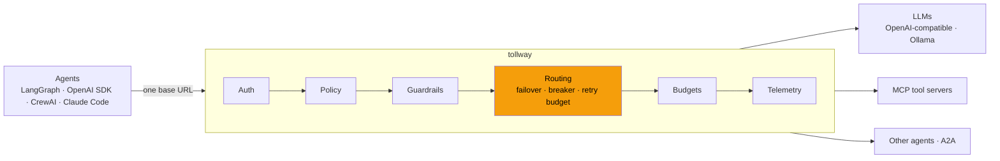

<div align="center">

# tollway

**One endpoint between your agents and everything they call.**

Failover, circuit breakers, budgets, tool policy and tracing for LLM, MCP and A2A traffic.<br>
Change one base URL. Keep your agent code.

[](https://github.com/heManKuMAR6/tollway/actions/workflows/ci.yml)
[](LICENSE)


</div>

> [!NOTE]
> tollway is being built in public. **v0.1 (LLM failover) is in progress** and not released yet.
> Everything below marked _planned_ does not exist yet. Star or watch the repo to follow along.

---

## The problem

Your agent works on your laptop. In production:

- **Your LLM provider returns 429s or goes down**, and every agent goes down with it.
- **A runaway agent loop** burns through your API budget overnight, and nobody notices until the invoice.
- **An agent connected to an MCP server sees every tool on it**, including `delete_repo`.
- **Each agent has its own retry logic, keys and model names**, so switching models means redeploying all of them.
- **Model calls, tool calls and handoffs are logged in different places**, if at all.

A normal API gateway can't fix this. MCP and A2A are JSON-RPC: every request is the same `POST` to the same path, responses stream, and one user request fans out into dozens of tool calls. The gateway can't tell `read_file` from `delete_repo`, can't count tokens, and can't fail over before the first streamed token.

## What tollway does

```python
from openai import OpenAI

client = OpenAI(base_url="http://localhost:8080/v1", api_key="...")

# "chat" is an alias. tollway maps it to an ordered failover chain.
client.chat.completions.create(model="chat", messages=[...])
```

```yaml
# tollway.yaml
aliases:
  chat:
    - name: primary
      url: https://api.openai.com/v1
      model: gpt-4.1-mini
      api_key: ${OPENAI_API_KEY}
      first_token_timeout: 2s
    - name: fallback
      url: http://ollama:11434/v1
      model: llama3.2:3b
```

When the primary returns 429, 5xx or misses its first-token deadline, tollway sends the request to the next backend before your agent sees an error. Every response tells you who served it:

```
x-tollway-backend: fallback
x-tollway-attempts: 2
x-tollway-request-id: 01J...
```

## How it works



Every request runs the same fixed pipeline. **Routing ships in v0.1**; the other stages land in later milestones behind fixed hook points, so the v0.1 request path doesn't change when they arrive.

## Features

| | Feature | Status |
|---|---|---|
| 🔀 | **Model aliases.** Clients ask for `chat`, operators decide what that means | v0.1, in progress |
| 🛟 | **Ordered failover** on 429, 5xx, connect errors and timeouts. Other 4xx pass through untouched | v0.1, in progress |
| ⚡ | **Circuit breaker** per backend (closed → open → half-open) | v0.1, in progress |
| 🪣 | **Retry budget.** A token bucket stops retry storms from piling onto a failing provider | v0.1, in progress |
| 🌊 | **Streaming-safe failover.** Fails over only before the first token, so two models' output is never spliced together | v0.1, in progress |
| 📏 | **Context-aware skip.** Backends too small for the prompt are skipped, not tried | v0.1, in progress |
| 🔑 | Virtual keys, token and spend limits, downgrade instead of hard failure | _planned (v0.2)_ |
| 🧰 | MCP gateway: per-key tool allowlists, argument scanning, audit log | _planned (v0.3)_ |
| 🔭 | OpenTelemetry traces agent → gateway → model → tool, Prometheus, Grafana | _planned (v0.4)_ |
| 🧪 | **Eval-gated failover** with [EvalForge](https://github.com/heManKuMAR6): a model joins a failover chain only after it proves its quality on shadowed live traffic | _planned (v0.5)_ |
| 🤝 | A2A agent registry and governed handoffs | _planned (v0.6)_ |

### Why not just use LiteLLM, agentgateway or Kong?

They're good tools, and you might want them. tollway differs in two ways:

1. **It checks quality, not just uptime.** Other gateways fail over to whatever is up. tollway pairs with EvalForge to score a candidate model against your primary on mirrored real traffic, and only lets it into a failover chain once it passes. _(planned, v0.5)_
2. **One control plane for all three traffic types.** LLM calls, MCP tool calls and agent-to-agent handoffs get the same keys, policy, budgets and traces.

A fuller, honest comparison will land with v0.1.

## Quickstart

_Coming with v0.1._ The goal: from a clean clone to a working gateway and failover demo in under 5 minutes, no paid API key needed.

```bash
git clone https://github.com/heManKuMAR6/tollway && cd tollway
docker compose -f deploy/docker-compose.yml up   # tollway + Ollama + a mock primary
./chaos/kill_primary.sh                          # watch x-tollway-backend switch to Ollama
```

## Receipts

Every milestone ships with a committed benchmark and a chaos script that proves its headline behavior. No claim in this README goes unbacked.

| Target (single instance, 2 vCPU) | Goal | Measured |
|---|---|---|
| Added latency, p50 | < 5 ms | _pending v0.1_ |
| Added latency, p95 | < 15 ms | _pending v0.1_ |
| Throughput | ≥ 500 req/s | _pending v0.1_ |
| Failover time | < 1 s | _pending v0.1_ |

Whatever the numbers turn out to be, they get published in [`bench/results/`](bench/).

## Roadmap

- [ ] **v0.1: Reliability.** Aliases, failover, circuit breaker, retry budget, streaming, chaos demo, benchmark
- [ ] **v0.2: Cost control.** Virtual keys, token and spend limits, Redis-backed shared state
- [ ] **v0.3: Tool security.** MCP gateway, per-key tool allowlists, audit log
- [ ] **v0.4: Observability.** OpenTelemetry, Prometheus, Grafana, admin UI
- [ ] **v0.5: Eval-gated routing.** Shadow traffic + EvalForge readiness reports
- [ ] **v0.6: Agent-to-agent.** A2A registry and governed handoffs

Each milestone is a tagged release with a runnable demo and a write-up on the _Agents in Production_ Substack.

## Development

```bash
uv sync
uv run ruff check && uv run ruff format --check && uv run mypy && uv run pytest
uv run uvicorn tollway.main:create_app --factory --port 8080
```

## Contributing

Early days, so issues and design feedback are the most useful contributions right now. Have an opinion on failover semantics, or a provider quirk that breaks streaming? [Open an issue](https://github.com/heManKuMAR6/tollway/issues).

## License

[MIT](LICENSE)

<div align="center">

**If your agents have ever gone down because a provider did, ⭐ the repo and follow the build.**

</div>
