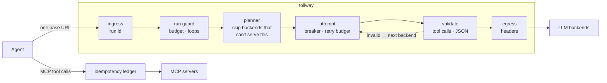

<div align="center">

# tollway

**A small, self-hosted gateway that keeps your agent running when a provider fails,
stops it when it loops, and stops a retry from repeating an action.**

Change one base URL. Keep your agent code.

[](https://github.com/heManKuMAR6/tollway/actions/workflows/ci.yml)
[](LICENSE)


</div>

> [!NOTE]
> tollway is being built in public. **v0.1 (failover) is in progress and not released yet.**
> Anything marked _planned_ does not exist yet.

---

## Three things that break agents in production

**1. The provider goes down, and the agent goes with it.**
A 429 storm or a 503 outage, and every agent that calls that provider stops. Rate-limit errors
are the most common LLM call failure in production. Worse, when you do have a fallback, it may
not support tool calling or JSON mode, so it returns a 200 your agent can't use, and your logs
call it a success.

**2. The agent loops, and the bill grows.**
An agent retries a failing tool or bounces between two steps for hours. Per-key rate limits
don't catch it, because each call looks normal. You find out from the invoice.

**3. A retry repeats an action.**
A tool call times out after the server has already done the work. The agent retries, and now
there are two GitHub issues, two emails, two charges. This bug has shown up in
[Microsoft Agent Framework](https://github.com/microsoft/agent-framework/issues/9204),
[Langflow](https://github.com/langflow-ai/langflow/issues/15321) and
[others](https://github.com/AgentWorkforce/relay/issues/1874).

tollway sits between your agent and the services it calls and fixes each of these in one place,
for every agent and framework.

## How it works

```python
from openai import OpenAI

client = OpenAI(base_url="http://localhost:8080/v1", api_key="unused")

# "chat" is an alias. tollway maps it to an ordered failover chain.
client.chat.completions.create(
    model="chat",
    messages=[{"role": "user", "content": "hi"}],
    extra_headers={"x-tollway-run-id": "task-42"},  # one id per agent task
)
```

```yaml
# tollway.yaml
aliases:
  chat:
    - name: primary
      url: https://api.openai.com/v1
      model: gpt-4.1-mini
      api_key: ${OPENAI_API_KEY}
      capabilities: [tools, json_mode]
    - name: local
      url: http://ollama:11434/v1
      model: qwen2.5:7b
      capabilities: [tools]
```



Every response tells you what happened:

```
x-tollway-backend: local
x-tollway-attempts: 2
x-tollway-failover-reason: http_429
x-tollway-request-id: 4f9c…
```

## Roadmap

| Release | Fixes | What you get | Status |
|---|---|---|---|
| **v0.1** | Provider failures | Model aliases, ordered failover on 429/5xx/timeouts, circuit breaker, retry budget, streaming-safe failover (never splices two models), skip backends that lack tools/JSON/context, fail over when a reply has a broken tool call or JSON | in progress |
| v0.2 | Runaway loops and cost | Per-run token, $ and step budgets; stop a run that repeats the same tool call N times | _planned_ |
| v0.3 | Repeated actions | MCP proxy with an idempotency ledger: a retried side-effecting call returns the first result instead of running again, and an unknown outcome is never replayed | _planned_ |

Each release ships with a chaos script that proves the fix and a committed benchmark.

## Why not LiteLLM, Bifrost or agentgateway?

They do a lot more, and if you need virtual keys, dashboards, dozens of providers or
Kubernetes-native MCP routing, use them. tollway is for when you want something different:

| | tollway | Typical gateway |
|---|---|---|
| Fails over on | HTTP errors **and** unusable replies (bad tool calls, broken JSON) | Usually HTTP errors; some support custom guardrail checks |
| Fallback selection | Skips backends that can't serve the request (tools, JSON mode, context) | Usually tries the next one in the list |
| Loop detection | Per agent run, by repetition _(planned)_ | Per key, by rate or spend |
| Retried tool calls | Deduplicated, unknown outcomes not replayed _(planned)_ | Passed through |
| Footprint | One process, no database, a handful of dependencies | Often Postgres + Redis + admin UI |

## Quickstart

_Coming with v0.1._ Goal: from a clean clone to a working failover demo in under 5 minutes,
with no paid API key.

```bash
git clone https://github.com/heManKuMAR6/tollway && cd tollway
docker compose -f deploy/docker-compose.yml up   # tollway + Ollama + a mock primary
./chaos/kill_primary.sh                          # watch x-tollway-backend switch to Ollama
```

## Benchmarks

Gateway overhead versus calling the backend directly, single instance, 2 vCPU. Whatever the
numbers are, they get published in [`bench/results/`](bench/).

| Metric | Target | Measured |
|---|---|---|
| Added latency p50 | < 5 ms | _pending v0.1_ |
| Added latency p95 | < 15 ms | _pending v0.1_ |
| Failover time | < 1 s | _pending v0.1_ |

## Development

```bash
uv sync
uv run ruff check && uv run ruff format --check && uv run mypy && uv run pytest
uv run uvicorn tollway.main:create_app --factory --port 8080
```

Design decisions live in [`docs/adr/`](docs/adr/). Contributor and agent instructions are in
[`CLAUDE.md`](CLAUDE.md).

## Contributing

Has one of these three problems bitten you? [Open an issue](https://github.com/heManKuMAR6/tollway/issues)
and describe what happened. Real incidents shape what gets built.

## License

[MIT](LICENSE)
